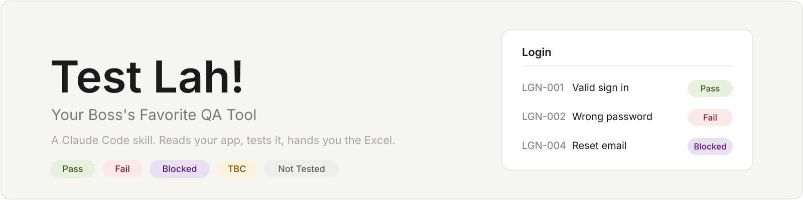

<p align="center">
  
</p>

**Just, Test lah!** A Claude Code skill that reads your project, asks only what the code can't tell it, tests the live app, and gives you one Excel workbook: results, evidence, UX notes, and an issues table your devs will actually read.

Click a section to open it.

<details open>
<summary><b>1. Install</b></summary>

<br>

```bash
claude plugin marketplace add niamhramadhaan/test-lah-skills
claude plugin install test-lah@test-lah-skills
```

Inside a Claude Code session you can use `/plugin` instead. If a command differs in your version, check `claude plugin --help`.

</details>

<details open>
<summary><b>2. Use it</b></summary>

<br>

Open the project you want to test, start Claude Code, and say any of these:

```text
Just, test lah!
/test-lah
test the dashboard and make me a QA workbook
```

</details>

<details>
<summary><b>3. What happens, step by step</b></summary>

<br>

| Step | What it does |
|---|---|
| 0. Profile | Reads `docs/qa/TEST-LAH.md` if it exists. Answers saved there are not asked again. |
| 1. Discover | Reads routes, roles, forms and API config. No questions yet. |
| 2. Intake | Asks what it couldn't learn (see below). Waits for your "go". |
| 3. Plan | Writes cases as data, one array per module. |
| 4. Run | Runs the cases, verifies every Fail, captures evidence while it runs. |
| 5. Build | Turns results into the workbook with `templates/build.js`. |
| 6. Report | Counts per status, urgent items first, what you need to provide. |

</details>

<details>
<summary><b>4. What it asks you</b></summary>

<br>

Options come from what discovery found in your code, not a fixed list.

- **Language** of results and suggestions: English, Indonesian, or mixed.
- **Modules** to cover, and **roles** to test as.
- **Environment**: base URL and who provides accounts. Passwords come from env vars and are never stored.
- **Workbook color**: neutral, your brand hex, or keep an existing workbook.
- **UX suggestions**: none, light, or full review.
- **Design check**: compare the deployed app with a Figma link, a Claude artifact or other HTML design, exported screens or brand tokens, if you have one.
- **State model**: map states and transitions first, so coverage is counted instead of guessed.

No one to answer (unattended run) and no saved profile? It stops and says what is missing. It does not guess.

</details>

<details>
<summary><b>5. What you get</b></summary>

<br>

One `.xlsx`:

- **Summary**: counts per module, issue heatmap, patterns seen in several modules, needs from the team.
- **One sheet per module**: test cases with status colors, screenshots for UI failures, request snippets for API-only failures.
- **Design Fidelity** (if you gave a design): design vs live, per screen, with side-by-side screenshots.
- **Issues to raise with the tech team**: under each module, Bug or Improvement, severity, suggested fix, minimal steps to reproduce.
- **Manual Tests**: Blocked cases and what the team must provide.
- **Legend**.

Statuses:

| Status | Meaning |
|---|---|
| Pass | Actual matches expected. |
| Fail | Actual differs. See the issues table. |
| Blocked | Needs a person, device or team action. |
| TBC | Ran, but the expected result waits for a decision. |
| Not Tested | Not run yet. |

Every Fail and urgent case carries evidence. The builder warns when one does not, and the skill fixes every warning before handing over.

</details>

<details>
<summary><b>6. Sample output</b></summary>

<br>

From [`sample-data.json`](skills/test-lah/templates/sample-data.json). Sheets: `Summary`, `Login`, `Design Fidelity`, `Manual Tests`, `Legend`.

**Summary**

| Module | Total | Pass | Fail | Blocked | TBC | Not Tested | Pass rate | Bugs |
|---|---|---|---|---|---|---|---|---|
| Login | 4 | 1 | 1 | 1 | 1 | 0 | 25% | 1 |
| Design Fidelity | 2 | 1 | 1 | 0 | 0 | 0 | 50% | 1 |
| **Total** | **6** | **2** | **2** | **1** | **1** | **0** | | |

**A module sheet** (some columns hidden here)

| ID | Scenario | Expected Result | Actual Result | Status | Evidence |
|---|---|---|---|---|---|
| LGN-001 | Valid credentials | User lands on **/dashboard** and sees a welcome toast. | Redirected to /dashboard with toast. | 🟩 Pass | |
| LGN-002 | Wrong password | Inline error **Invalid credentials**; no redirect. | Page reloads with no message. The request returned 401. | 🟥 Fail | API snippet, below |
| LGN-003 | Session after logout | Login page is shown. | Observed (expected still TBC): dashboard stays visible after Back. | 🟦 TBC | |
| LGN-004 | Reset email arrives | Email arrives within 1 minute. | Needs a real inbox. | 🟨 Blocked | |

API-only Fail evidence (LGN-002), secrets masked:

```text
POST /auth/login
{"email": "***", "password": "***"}
-> 401 Unauthorized
{"message": "Invalid"}
```

**Design Fidelity**

| ID | Scenario | Expected Result (design) | Actual Result (live) | Status |
|---|---|---|---|---|
| DSG-001 | Login: layout and copy | Logo, heading **Welcome back**, email, password, **Sign in** button, in that order. | Matches design. | 🟩 Pass |
| DSG-002 | Login: typography and color | Heading **Inter 600 24px**; button radius **8px**. | Heading 20px (design 24px). Button radius 4px (design 8px). | 🟥 Fail |

```text
h1 font-size: 20px (design 24px)
.btn-primary border-radius: 4px (design 8px)
```

**Issues to raise with the tech team** (below each module's cases)

| Type | Severity | Issue | Suggested fix | Reference |
|---|---|---|---|---|
| Bug | High | **Wrong password shows no message.** The user cannot tell what failed. | **Show an inline error under the form.** Keep the entered email. | LGN-002 |

**Builder warnings** you would see on bad data:

```text
WARNING: Fail without an issue row: LGN-002
WARNING: Fail or urgent case without evidence (shot or snippet): DSG-002
WARNING: screenshot file not found: LGN-005 shots/lgn-005.png
```

</details>

<details>
<summary><b>7. Safety on staging</b></summary>

<br>

- Test data starts with `qa-` and is deleted afterwards. Real data is never changed.
- Settings pages: writes are answered with fake responses in the browser. Such results are labeled and are not proof of backend behavior.
- Permission checks use deliberately invalid request bodies, never valid ones with a low-privilege token.
- No passwords, secrets or tokens are printed or stored.
- It asks first before anything that touches a live system (real email, payments, device control).

Full list: [`safety.md`](skills/test-lah/references/safety.md).

</details>

<details>
<summary><b>8. Build the workbook yourself</b></summary>

<br>

```bash
npm i exceljs@4.4.0
node skills/test-lah/templates/build.js skills/test-lah/templates/sample-data.json out.xlsx
```

The input format is in [`workbook-spec.md`](skills/test-lah/references/workbook-spec.md) and [`sample-data.json`](skills/test-lah/templates/sample-data.json). If `out.xlsx` is open in Excel, it writes `out.next.xlsx` instead.

</details>

<details>
<summary><b>9. What's in the repo</b></summary>

<br>

```text
skills/test-lah/
  SKILL.md                       workflow, intake, rules
  references/discovery.md        how to learn a project cheaply
  references/workbook-spec.md    columns, statuses, formatting, data contract
  references/safety.md           rules for staging and shared environments
  references/ux-review.md        optional UX checklist
  references/design-fidelity.md  optional design vs deployed checks
  references/state-model.md      optional state and transition coverage
  references/harness-lessons.md  Playwright and ExcelJS pitfalls
  templates/build.js             JSON to Excel builder
  templates/sample-data.json     example input
```

Reference files load only when a step needs them, so a run that skips UX review never pays for it.

</details>

<details>
<summary><b>10. Known gaps</b></summary>

<br>

- No stacked-bar chart image on Summary yet.
- The builder was checked by reading the generated file back, not by opening it in Excel.
- Install commands are from memory of the Claude Code CLI; verify with `claude plugin --help`.

</details>
